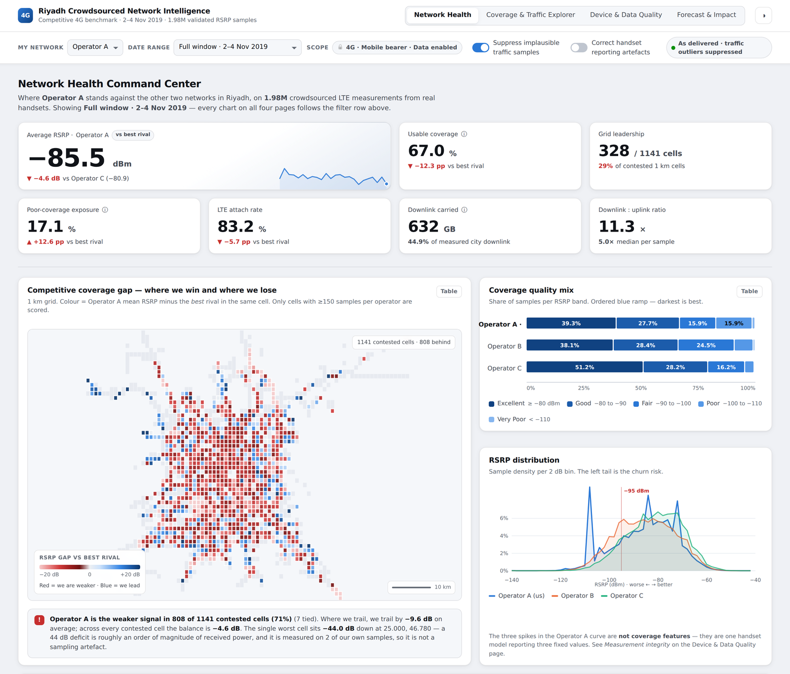
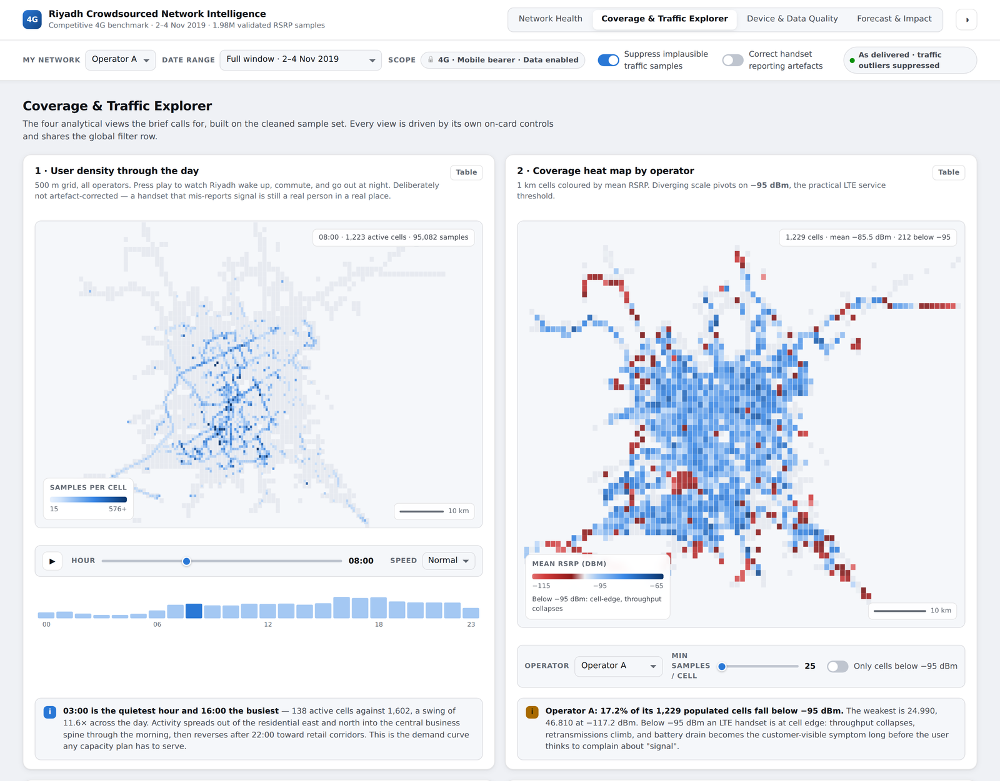
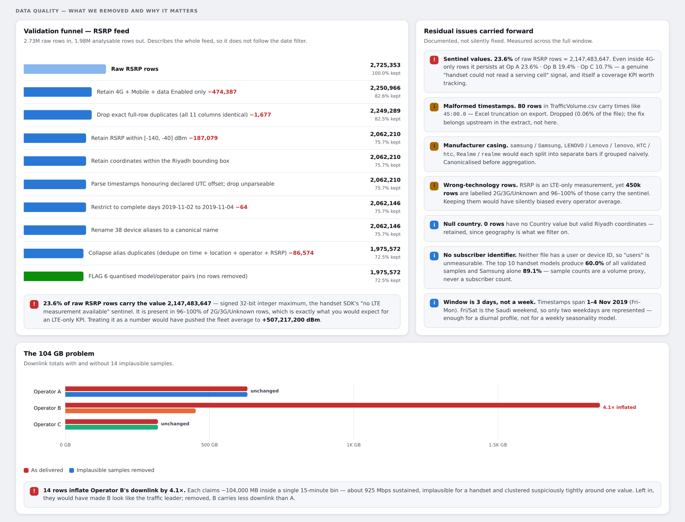

# Riyadh 4G Crowdsourced Network Intelligence

Competitive benchmarking of three LTE networks in Riyadh, built on 2.7 million crowdsourced handset measurements — with the data-quality audit that had to happen first, and a result that did not go the way I expected.



---

## The question, and the answer

The project started with an assumption that sounds obvious: **better coverage should carry more traffic.** Weak signal, worse experience, less data consumed, so invest there.

The first look agreed. Signal strength and downlink traffic were clearly correlated.

Then I compared like with like — traffic against signal strength **within the same 1 km cell and the same hour of day**, so a business district was never being weighed against a quiet suburb. The relationship disappeared:

> A 10 dB improvement in RSRP was associated with a **−2.4% change in downlink traffic (p = 0.57)**. Statistically indistinguishable from zero, and pointing the wrong way.

The original correlation was population density appearing on both sides of the comparison. Busy areas generate more traffic, and busy areas also receive more network investment. Control for place and time, and the effect goes with it.

**Conclusion:** this dataset alone cannot justify a coverage-based business case. For that decision I would instrument per-cell throughput and RRC-connected user counts, which sit much closer to the outcome anyone actually cares about — quality of experience, not volume.

---

## What's in this repo

```
images/                                   Dashboard screenshots
```

The raw datasets are **not** included

---

## Method

### 1. Validation before analysis

Nothing was analysed until the feed survived an audit. Four defects mattered enough to change conclusions:

| Defect | Scale | Why it matters |
|---|---|---|
| Sentinel value `2147483647` reported as signal strength | 23.6% of raw rows | `2³¹−1`, the SDK's "no measurement available". Read as a number it pushes the fleet mean to +507,217,200 dBm. Present in 96–100% of 2G/3G/unknown rows, exactly as an LTE-only KPI should be. |
| Implausible traffic records | 14 rows of 102,000 | Each claims ~104,000 MB inside one 15-minute bin — about 925 Mbps sustained on a handset. Left in, they inflate one operator's downlink 4.1× and flip the traffic ranking. |
| Alias duplicates | 7.5% of validated rows | The collection SDK resolves one hardware ID to several commercial names (Galaxy J7 Prime / Galaxy On Nxt are one phone; 33,404 duplicated groups). Double-weights those locations in every spatial average. |
| Quantised handset reporting | 6 model/operator pairs | Three fixed RSRP values instead of a continuous measurement. Produces spikes in the distribution that read as a coverage feature and are not one. |

Every exclusion is logged as a rule, a row count and a reason:

**2,725,353 raw rows → 1,975,572 analysable rows (27.5% removed).**

The two defects that could be *corrected* rather than dropped are exposed as toggles in the dashboard, so the effect of each correction is visible rather than assumed.

### 2. Competitive benchmarking

Operators are compared on a 1 km equal-degree grid, scored only in cells where **every** operator has ≥150 samples, so the comparison is never an artefact of one network having better sampling in a given place. Reported as an RSRP delta against the best rival in the same cell, plus a ranked action list weighted by deficit × sample volume — worst coverage where the most users actually are.

### 3. Coverage-uplift elasticity

Elasticity of traffic to RSRP, estimated with **cell and hour fixed effects** (and a stricter cell × hour specification as a robustness check). This is the model that produced the null result above. The point estimates are negative or indistinguishable from zero across both directions and both specifications.

### 4. Forecasting

24-hour-ahead traffic forecasts per operator and direction, benchmarked against naive, seasonal naive, Holt-Winters, gradient boosting and Prophet.

SARIMA(1,0,0)(1,0,0,24) on log traffic wins at **MASE 0.76**, roughly 24% better than seasonal naive. The 80% prediction interval spans about 1.8× the central estimate and is reported that way deliberately — with 72 observations there is no honest way to claim a tighter one.

---

## The dashboard

Four pages, twenty linked views, delivered as a **single self-contained HTML file** that runs offline. No server, no build step, no map tile service — the basemap is derived from the sample footprint itself.

- **Network Health** — competitive position, coverage-gap map, hourly demand and coverage, ranked action list
- **Coverage & Traffic Explorer** — animated 24-hour user density, coverage heat maps, traffic hotspots, handset RSRP comparison
- **Device & Data Quality** — does coverage convert into traffic, handset fleet benchmarks, and the full measurement-integrity evidence
- **Forecast & Impact** — next-24h forecast, trend significance, elasticity and scenario modelling

Every filter is live: switching which operator you benchmark re-frames all twenty views, the date range re-slices weekend against weekday, and both data-treatment switches recompute the affected charts. Every chart has a table view behind it. Light and dark themes.


## Limitations, stated up front

- **There are no subscriber or device identifiers in the data.** "Users" cannot be measured. Everywhere this project says users, it means *measurement samples* — a single heavy handset can contribute thousands. Ten models account for 57.4% of all validated samples, so device-level readings are indicative of those handsets in those places, not of market share.
- **Three days is the binding constraint.** No weekly seasonality, no holiday effects, no trend identification. Every limitation in the forecasting section traces back to the window length rather than the method.
- **Crowdsourced coverage is opportunistic.** Sample density follows where people are, not where the network is, which is why cross-operator comparisons are gated on minimum per-cell sample counts.

---

## Stack

**Python** — pandas, NumPy, statsmodels, Prophet, scikit-learn
**Visualisation** — Tableau, and a hand-built HTML/CSS/JS dashboard with a token-based design system
**Analysis** — data validation, EDA, spatial binning, confounding and fixed-effects analysis, time-series forecasting, competitive benchmarking

---

## Screens

| | |
|---|---|
|  |  |
| Animated 24-hour density and coverage heat maps | The validation funnel and measurement-integrity evidence |

---

Built by **Mohamed Ellaithy**. Questions and corrections welcome — open an issue.
